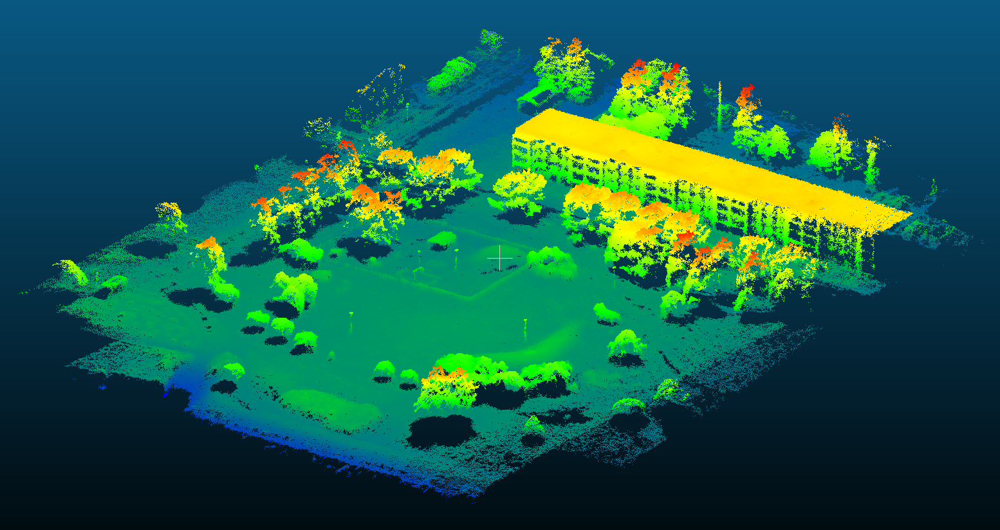

<p align="center">
  <picture>
    <source media="(prefers-color-scheme: dark)" srcset="docs/images/pose-logo-dark.png">
    
  </picture>
</p>

# POSE

**Photogrammetric Orientation and Surface Estimation.** POSE turns overlapping photographs into
georeferenced point clouds, surface models, terrain models and orthomosaics. It is written in
Java, uses OpenCL for dense matching and depth fusion, and runs on its own or as part of
[LAS.utils](https://github.com/kmik/LAS.utils).



## Features

- Camera alignment and bundle adjustment, with automatic or supplied calibration and poses.
- Georeferencing from image GPS, and from ground control points pinned in a browser editor.
- Georeferencing to an airborne lidar reference (LAS or LAZ), without ground control points.
- Dense matching (semi-global matching, optionally multi-view) with multi-view depth fusion.
- Ground classification with a terrain model and a canopy height model.
- Full-resolution orthomosaic as a tiled GeoTIFF: true (no lean, gaps left open) or classic (no holes).
- LAS and PLY point clouds, DSM, DTM and a PDF processing report.
- The pipeline runs in one go or one step at a time.
- A desktop window (`pose-gui.bat`, `pose-gui.sh`) to start, follow and inspect runs, with a 3D view.

## Build

You need a 64-bit JDK 25 or later. The first build downloads the dependencies into `lib/`.
A vendor OpenCL runtime enables GPU processing; without one everything runs on the CPU.
Windows x64 and Linux x64 are supported.

```powershell
# Windows
.\build.bat
.\photogrammetry.bat -h
```

```bash
# Linux
bash build.sh
bash photogrammetry.sh -h
```

The build scripts compile the program and run its tests. `pose.bat` and `pose.sh` start the same
program. For machines without a suitable Java, see the [portable release](PORTABLE_INSTALL.md).

## Quick start

```powershell
.\photogrammetry.bat -i .\images -o .\projects\forest --quality medium --classify-ground
```

The results are in `projects\forest\runs\<run-id>\07_results\`: `dense.las`, `dense.ply`,
`dsm.tif`, `dtm.tif` and `processing-report.pdf`. Each run gets its own folder; earlier runs are
kept. Run with `-h` for every option.

## Step by step

Each step saves its state, so the next one can run later or with different settings.

| Step | Does |
| --- | --- |
| `inputs` | reads the images and starts a new run |
| `calibrate` | camera calibration (supplied, from EXIF, or estimated) |
| `match` | features, image pairs and tie points |
| `align` | camera alignment and bundle adjustment |
| `cleanup` | tie-point cleanup by quality (only with `--tie-point-cleanup`) |
| `georeference` | GPS georeferencing and the GPS-weighted adjustment |
| `lidar` | moves the block onto a lidar surface (only with `--lidar-reference`) |
| `gcp` | ground control points (only with `--gcp`) |
| `dense` | dense matching and fusion: the point cloud |
| `ground` | ground classification (only with `--classify-ground`) |
| `finish` | report and final files |

```powershell
.\photogrammetry.bat inputs -i .\images -o .\projects\forest --quality medium
.\photogrammetry.bat calibrate match align georeference -o .\projects\forest
.\photogrammetry.bat dense ground finish -o .\projects\forest --min-views 2 --classify-ground
```

`--run ID` continues an older run, and `--branch` redoes a step with other settings in a new run
without touching the original. `examples/forest_4_steps.ps1` is a complete example.

## Ground control points

Write the points to a CSV file in the output coordinate system (`--crs`, default EPSG:3067).
`type` is `control` (used in the adjustment) or `check` (only measured):

```text
gcp_id,x,y,z,sx,sy,sz,type
G1,605551.06,6938380.02,89.55,0.02,0.02,0.03,control
G2,605553.10,6938371.44,88.10,,,,check
```

```powershell
.\photogrammetry.bat calibrate match align georeference gcp -o .\projects\forest --gcp .\gcps.csv
.\photogrammetry.bat gcp-edit -o .\projects\forest     # pin the points in the browser
.\photogrammetry.bat gcp dense ground finish -o .\projects\forest
```

At least three control points pinned in two or more images each are needed (one is enough when
the images have GPS). `--gcp-check auto` holds some points back as check points automatically.

## Lidar reference

`--lidar-reference FILE|FOLDER` (LAS or LAZ tiles, for example national airborne laser scanning)
georeferences the block to the lidar instead of ground control: after the GPS fit, the shifts,
tilts and heading that put the tie points onto the lidar surface are estimated (scale with
`--lidar-scale on`) and applied before dense matching, so all products are in the lidar's
coordinate system and height datum. The lidar must cover the whole block; open ground and roofs
count more than canopy, canopy height may differ (older lidar), and parameters the terrain cannot
determine stay at their GPS values. The report shows the parameters with their uncertainty and
difference maps against the lidar. Options: `photogrammetry --help lidar`.

## Common options

| Option | Default | Effect |
| --- | --- | --- |
| `--quality` | `custom` | `ultra`, `high`, `medium`, `low`: images at full, 1/2, 1/4 or 1/8 size. |
| `--max-dimension` | `1600` | Longest image side for `custom` quality. |
| `--step` | `2` | Dense sample spacing in pixels. |
| `--filtering` | `moderate` | `mild`, `moderate` or `aggressive` depth filtering. |
| `--min-views` | `3` | Images that must agree on a point. |
| `--crs` | `EPSG:3067` | Output coordinate system. |
| `--camera-grouping` | `auto` | Which images share one camera calibration. `auto`: camera IDs of an imported orientation, else `--camera-groups`, else EXIF make, model, serial and focal length; also `single`, `per-image`. Images of different sizes are always separate cameras; the cameras are listed in `01_calibration/cameras.json`. |
| `--camera-groups` | none | CSV `image,camera` naming the camera of every image. |
| `--calibration CAMERA=FILE` | none | One camera's calibration (repeatable), in any supported calibration format holding one camera (POSE `camera.txt`, `calib.result`, OpenCV, Metashape, MicMac, one-camera COLMAP/INPHO). CAMERA is a `--camera-groups` name or `camera_1`, `camera_2`, ... (EXIF grouping). `--intrinsics-mode`, `--orientation-pixel-size`, `--focal` and `--s_w` also take `CAMERA=VALUE`; `--intrinsics-mode CAMERA=free` ignores that camera's supplied calibration. A multi-camera INPHO, Metashape, COLMAP, openMVG, OpenSfM or CSV file goes to `--orientation-input`; its camera IDs name the cameras. |
| `--quick-calibration` | `on` | Focal starts from EXIF/XMP without the focal bootstrap; `off` (or `--calibration-pipeline bootstrap`) restores the earlier default. Runs started before the change continue with `off`. |
| `--calibration-trial-method` | `full` | How the lens is refined after alignment. `full`: one parameter per trial, each a whole-block bundle adjustment (skipped above about 120 cameras per camera model, where none can be accepted). `subset`: the same trials on a compact set of cameras near the block centre (`--calibration-trial-cameras`, default 100), then one whole-block fit of the chosen model, kept only if it improves the whole block. `joint`: unsupported parameters dropped first, the rest fitted together once. Use `subset` or `joint` for large blocks. |
| `--calibration-acceptance` | `strict` | How a lens fit after alignment is accepted. `strict`: both held-out track groups must improve by 0.5% and by more than a complexity penalty. `relaxed`: neither held-out group may get worse and every fitted parameter must move by at least three standard deviations; can also accept the focal length, which on flat nadir blocks is better left to the GPS-weighted adjustment. Held-out scores cap gross mismatches in both modes. |
| `--classify-ground` | off | Ground classes, `dtm.tif` and `chm.tif`. |
| `--orthomosaic` | off | Full-resolution true orthomosaic. |
| `--orthomosaic-mode` | `true` | `classic`: smoothed, gap-free surface and no visibility test, so no holes inside the photographed area; tall objects lean. |
| `--dense-method` | `sgm` | `mvsgm` matches several neighbouring images at once (needs `--fusion-mode image`). |
| `--block-processing` | `off` | `auto` or `on` splits very large image sets into overlapping blocks. |
| `--registration-bundle-growth` | `15` | Bundle adjustment during camera registration each time the registered set has grown by this percent; `0` turns it off. |
| `--pair-selection` | `auto` | Which image pairs are matched. `auto` uses the nearest GPS images when every image has GPS (spread over at least 20 m), otherwise a visual search; also `overlap`, `gps`, `sequential`, `all`. |
| `--gps-neighbors` | `0` | Also match each image with its N nearest GPS images, on top of `--pair-selection`. |
| `--feature-grid` | `0` | Spread the `--features` keypoints over N grid cells along the longer image side (for example `16`) instead of keeping the strongest overall. |
| `--match-repair` | `off` | `on` matches weakly connected images (few accepted pairs, or a separate part of the match graph) against more nearby images. |
| `--registration-recovery` | `off` | `on` grows further models from unregistered images and merges them via shared images or GPS, then tries GPS-checked PnP. Reasons per image are always in `04_geometry/registration.json`. |
| `--registration-pose-check` | `off` | `on` (needs GPS) rejects camera poses that land far from their GPS position or are tilted beyond the rest of the block, during registration and after each bundle adjustment. |
| `--tiled-las-output` | `0` | Size of square LAS tiles in output units (for example `1000`); `0` writes one `dense.las`. |
| `--compute` | `auto` | `cpu` or `gpu` force one. |
| `--cores` | half the CPUs | CPU threads. |
| `--memory-mb` | `2048` | Processing buffer budget in MiB, not a total RAM limit: the Java heap is set to about this / 0.65 (56000 gives an 84 GB heap), and native memory (OpenCV, SIFT, GPU buffers) comes on top. |
| `--ram-limit-mb` | `0` | Total RAM planning ceiling (0 = detect the host or job limit). Caps the heap at 65% and throttles parallel feature extraction and pair matching using memory estimates. This is not a hard RSS limit. Example 52,000 MiB planning ceiling: `--memory-mb 22000 --ram-limit-mb 52000`. |
| `--fusion-source-maps` | `retained` | Opt-in `scoped` releases MVSGM source mappings after copying; keeps required files and existing fusion planning. |
| `--fusion-host-memory-mb` | `0` | Opt-in shared host-memory accounting and bounded source/fusion page cache. Zero disables this path; this is not a hard RSS limit. |
| `--fusion-host-cache-mb` | `512` | Shared page-cache payload cap in MiB when the host-memory option is enabled. |

`--estimate-memory` shows the memory plan without processing.

## LAS.utils

Copy this repository into `sgm_java/` at the LAS.utils root, copy the wrappers from `las-utils/`
into that root, and build the module. The Java entry point is `photogrammetry`.

## Limitations

- Automatic calibration needs good overlap and camera geometry; otherwise supply a calibration.
- With GPS only, heights follow the EXIF GPS altitude (no geoid conversion). Use GCPs or a lidar
  reference for a surveyed height datum.
- A lidar reference corrects the block as a whole (one rigid transformation), not its bending.
- Under closed canopy the terrain is interpolated from the nearest visible ground.

## Documentation

- [Pipeline steps and ground control points](docs/PIPELINE_STEPS.md)
- [Desktop window](docs/GUI.md)
- [Project layout](docs/PROJECT_FORMAT.md)
- [Orientation formats](docs/ORIENTATIONS.md)
- [Ground classification](docs/GROUND_CLASSIFICATION.md)
- [Orthomosaic and automatic check points](docs/ORTHOMOSAIC.md)
- [Multi-view SGM](docs/MULTIVIEW_SGM.md)
- [Scoped MVSGM source maps and measurements](docs/FUSION_SOURCE_MAPS.md)
- [Bounded host fusion memory](docs/FUSION_HOST_MEMORY.md) and [validation](docs/FUSION_HOST_MEMORY_VALIDATION.md)
- [Pair matching memory and validation](docs/MATCHING_MEMORY_20261118.md)
- [Thin surfaces](docs/THIN_SURFACES_FUSION.md)
- [Quick calibration](docs/QUICK_CALIBRATION.md)
- [Portable releases](PORTABLE_INSTALL.md)
- [Third-party dependencies](THIRD_PARTY_NOTICES.md)

Author: [Mikko Kukkonen](https://github.com/kmik). No project license has been selected;
dependencies keep their own licenses.
