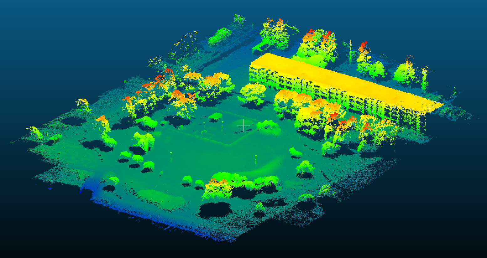

# Collinea

**From overlapping photographs to georeferenced point clouds.**

Collinea is a Java photogrammetry tool with OpenCL acceleration, semi-global stereo matching and multi-view depth fusion. Run it as a standalone command-line program or integrate it with [LAS.utils](https://github.com/kmik/LAS.utils).



*Example reconstruction, colored by elevation. Image supplied by the maintainer.*

## Features

- Feature matching, camera registration and joint bundle adjustment.
- Shared focal/radial-distortion estimation when constrained by the imagery; measured camera calibration and poses can be fixed, prior-constrained or refined from initial values.
- Census, AD-Census, Census-gradient and ZNCC stereo costs, automatic pair-specific disparity ranges and configurable filtering intensity.
- OpenCL SGM and depth fusion, allocation banks, continuous strip streaming, exact range-proved aggregate storage and CPU fallbacks.
- Reprojection-based depth refinement and normal-aware consolidation with distinct-camera support and resolved-layer checks.
- LAS/PLY clouds, surface normals, roughness/planarity diagnostics and aligned point-confidence records.
- GPS georeferencing, orientation interchange, reusable project directories and optional detailed diagnostics/caching.

## Requirements and build

Use a **64-bit JDK 25 or newer**, with `JAVA_HOME` set or `java`/`javac` on PATH. The build downloads OpenCV 4.9.0-0, Proj4J 1.4.3 and Proj4J EPSG 1.4.3 into `lib/`; subsequent builds reuse them. No system OpenCV, C++ compiler or CUDA toolkit is needed.

Windows x64 is exercised locally. Linux x64 with glibc has launch/build scripts and configured CI, but its runtime still needs validation; Alpine/musl is unsupported. GPU operation additionally needs a vendor OpenCL runtime; GPU fusion/surface kernels require FP64. CPU processing works without OpenCL.

From the repository root:

```powershell
# Windows PowerShell
.\build.bat
.\photogrammetry.bat -h
```

```bash
# Linux
bash build.sh
bash photogrammetry.sh -h
```

Both scripts compile and run the numerical/integration suite, creating fixtures under `target/`. `mvn package` compiles and copies dependencies but does not run the custom integration suite. Local `tools/jdk-25*` installations are recognized by Windows launchers and excluded from source control.

## Reconstruct a project

```powershell
.\photogrammetry.bat `
  -i .\images `
  -o .\projects\city `
  --max-dimension 1600 `
  --step 2 `
  --filtering moderate `
  --neighbors 5 `
  --min-views 3 `
  --memory-mb 4096
```

```bash
bash photogrammetry.sh \
  -i ./images \
  -o ./projects/city \
  --max-dimension 1600 \
  --step 2 \
  --filtering moderate \
  --neighbors 5 \
  --min-views 3 \
  --memory-mb 4096
```

Omit calibration to attempt automatic estimation. Ambiguous geometry or insufficient focal information can prevent a reliable solution; supply measured calibration when needed. Supplied calibration/poses are **fixed by default**; choose `--intrinsics-mode prior|initial` or `--extrinsics-mode prior|initial` to refine them. See [orientation interchange](ORIENTATIONS.md).

Running without arguments, or with `-h`, prints every argument and examples.

## Resolution and resources

| Setting | Purpose |
| --- | --- |
| `--quality ultra|high|medium|low` | Original dimensions divided by 1, 2, 4 or 8; never upsample |
| Default quality: `custom` | Fit within `--max-dimension`, default 1600 on the longest side; smaller images stay smaller |
| `--filtering mild|moderate|aggressive` | Depth filtering strength, independent of resolution |
| `--step N` | Sample candidates every N pixels in each axis; smaller means more fusion work |
| `--compute auto|cpu|gpu` | Stereo backend; auto chooses eligible GPU plans and retains CPU fallback |
| `--memory-mb N` | Processing budget in MiB; launchers enlarge Java heap when necessary |
| `--gpu-memory-mb N` | Device-memory budget in MiB; omitted defaults to 70% of reported VRAM |
| `--gpu-sgm streamed` | Bounded GPU strips and continuous path state; temporary disk required |
| `--sgm-aggregate auto|16|32` | Exact aggregate storage with a proved bound and automatic 32-bit fallback |
| `--point-attributes surface|none` | Surface attributes or compact XYZ/RGB clouds |

Java heap, native OpenCV allocations, GPU buffers and temporary files are separate resource pools. Leave physical RAM for native processing and the operating system. Use `--estimate-memory` to inspect a workload. See [performance/storage details](PERFORMANCE_AND_ATTRIBUTES.md).

## Project outputs

Each invocation creates `<output>/runs/<run-id>/`:

```text
00_inputs/       Image inventory and processing metadata
01_calibration/  Source/processed interior orientations
02_features/     Feature diagnostics, depending on storage profile
03_matches/      Pair and track diagnostics
04_geometry/     Final camera poses and reusable orientation model
05_stereo/       Stereo ranges and depth/disparity diagnostics
06_fusion/       Fusion/consolidation metrics and performance reports
07_results/      Final LAS/PLY clouds and point-confidence.csv.gz
```

Interior/exterior orientation archives are saved automatically. Additional interchange formats can be exported during processing or afterward with `--export-orientations RUN_DIRECTORY`. Photos need not be reprocessed. See [project layout](PROJECT_FORMAT.md).

`--storage standard` avoids exhaustive intermediates; `--storage debug` keeps detailed diagnostics. Reuse caching is opt-in with `--cache`. Working depth/surface files are cleaned up after use; existing project runs are retained.

## LAS.utils integration

Copy this project into `sgm_java/` at the LAS.utils repository root. Copy the wrappers from `las-utils/` into the LAS.utils root and build the module there. Its dedicated classpath avoids mixing packaged OpenCV 4.9 with LAS.utils' older jar. The default-package entry point is `photogrammetry`.

## Accuracy and current limits

This tool is under active development. Estimated stereo uncertainty excludes camera/GPS errors, and local smoothness does not establish survey accuracy. GPS supplies a horizontal georeference, default EPSG:3067; EXIF altitude has an unspecified vertical datum and no geoid/N2000 correction is applied. Negative Z values can be valid.

SGM streaming does not yet provide fully windowed image processing. Native-resolution large aerial blocks and camera rigs need further scaling work. LAS uses version 1.2, point format 2 with optional Extra Bytes, and a maximum of 4,294,967,295 points per file. Attribute display depends on the reader; the aligned CSV remains available.

## Documentation

- [Surface processing, performance and exported attributes](PERFORMANCE_AND_ATTRIBUTES.md)
- [Orientation formats and conventions](ORIENTATIONS.md)
- [Project artifacts](PROJECT_FORMAT.md)
- [Storage and GPU processing](STORAGE_GPU.md)
- [Thin structures and SGM penalties](THIN_STRUCTURES.md)
- [Validation evidence and limitations](VALIDATION.md)
- [Third-party dependencies](THIRD_PARTY_NOTICES.md)

Maintained by [kmik](https://github.com/kmik). No project license has been assigned yet; third-party components retain their own licenses.
